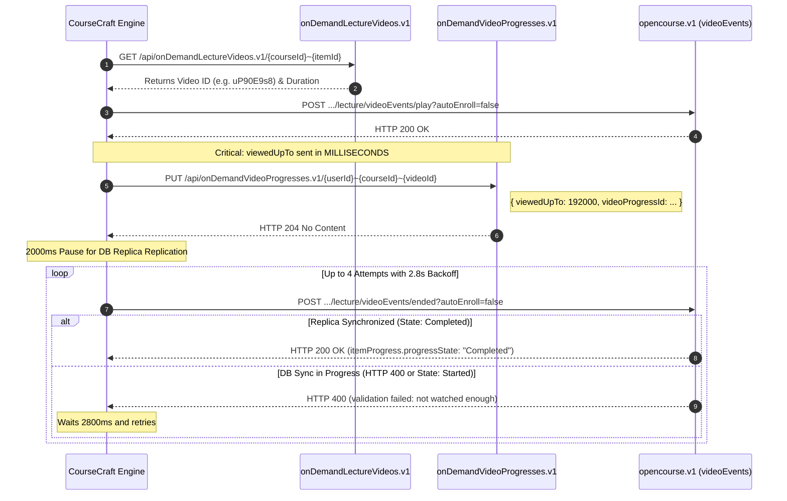

# How CourseCraft Works: Architectural Deep-Dive & Protocol Reference 🔬

**CourseCraft** is a local-first, privacy-respecting browser extension built on the Chrome Manifest V3 specification. It interacts directly with Coursera's public and internal REST/GraphQL APIs, executing operations from the authenticated learner's browser session.

This document outlines the internal mechanics, reverse-engineered protocol handshakes, and synchronization strategies used by CourseCraft.

---

## 🏗️ 1. Architecture Overview

```
┌────────────────────────────────────────────────────────────────────────┐
│                          User Browser Window                           │
│                                                                        │
│   ┌─────────────────────┐                 ┌────────────────────────┐   │
│   │   Coursera Web Page │                 │    CourseCraft Popup   │   │
│   │   (coursera.org)    │                 │       (popup.html)     │   │
│   │                     │                 │                        │   │
│   │  ┌───────────────┐  │  chrome.runtime │  ┌──────────────────┐  │   │
│   │  │  content.js   │◄─┼─────────────────┼──┤    popup.js      │  │   │
│   │  │(Worker Engine)│  │    messages     │  │ (UI Controller)  │  │   │
│   │  └───────┬───────┘  │                 │  └────────┬─────────┘  │   │
│   └──────────┼──────────┘                 └───────────┼────────────┘   │
│              │                                        │                │
│              ▼                                        ▼                │
│   ┌──────────────────────────────────────────────────────────────┐     │
│   │               Background Service Worker                      │     │
│   │                    (background.js)                           │     │
│   │   - Cookie Jar Extraction (CSRF3-Token, __204u)              │     │
│   │   - Tab Orchestration & Keyboard Commands                    │     │
│   └──────────────────────────┬───────────────────────────────────┘     │
│                              │                                         │
└──────────────────────────────┼─────────────────────────────────────────┘
                               │
                               ▼ Direct HTTPS Requests
          ┌───────────────────────────────────────────────┐
          │            Coursera Backend Services          │
          │                                               │
          │  - /api/onDemandCourseMaterials.v2 (Syllabus) │
          │  - /api/onDemandVideoProgresses.v1 (Progress) │
          │  - /api/opencourse.v1/.../videoEvents (Ended) │
          │  - /api/onDemandSupplementCompletions.v1      │
          │  - /graphql-gateway (AI Coach Chat Sessions)  │
          │  - /api/onDemandWidgetProgress.v1 (Sandbox)   │
          └───────────────────────────────────────────────┘
```

---

## 🔑 2. Session & Credential Detection

Coursera enforces CSRF (Cross-Site Request Forgery) protection and user authentication across all mutative API calls:

1. **CSRF Extraction**:
   - The extension reads the `CSRF3-Token` or `csrf3-token` cookie from `document.cookie`.
   - If not directly accessible via DOM (due to cookie scopes), the background service worker fetches it using the Chrome `cookies` API and provides it via internal messaging.
   - The token is attached as an `X-CSRF3-Token` HTTP header on all mutative requests.

2. **User Identity & Email Resolution**:
   - Coursera mounts initial application state on the page inside `<script>window.App = { ... };</script>`.
   - CourseCraft inspects `window.App.context.dispatcher.stores.ApplicationStore.userData`:
     - `userData.id`: The user's unique numeric learner ID (e.g., `161276145`).
     - `userData.email_address`: The user's account email address.
     - `userData.fullName`: The user's legal account name.
   - These values are cached in local browser storage (`chrome.storage.local`) and reflected in the extension popup. Learners can also manually override their numeric User ID at any time.

---

## 🎥 3. Video Lecture Completion Protocol

Coursera's video player verifies watch engagement using a distributed progression system:



### Key Discoveries & Implementation Rules:
1. **Millisecond Precision**:
   Coursera stores and validates video duration in **milliseconds** (`timeCommitment: 192000`). Sending watch time in seconds caused Coursera to record 192 ms out of 192,000 ms ($0.1\%$ completion), leading to validation rejection. CourseCraft guarantees duration is scaled to full milliseconds.
2. **Database Propagation Synchronization**:
   When `PUT onDemandVideoProgresses.v1` succeeds (HTTP 204), Coursera writes progress asynchronously across distributed database replicas. Calling the `ended` endpoint too quickly reads from an uncommitted replica, generating:
   `"Video completion validation failed. You have not watched enough of the video to mark it as completed"`
   CourseCraft inserts an initial **2,000 ms write delay** followed by an **automated retry loop** (up to 4 attempts) until the replica acknowledges `progressState: "Completed"`.
3. **Course Slug vs. Course ID**:
   The URL path for `videoEvents` strictly expects the human-readable URL slug (e.g., `introduction-to-engineering-design`), not the opaque course ID.

---

## 📖 4. Reading Materials & Supplements Protocol

For readings, articles, and supplementary materials, Coursera employs `onDemandSupplementCompletions.v1`:

- **Endpoint**: `POST https://www.coursera.org/api/onDemandSupplementCompletions.v1`
- **Payload**:
  ```json
  {
    "userId": 161276145,
    "courseId": "TNeeR9xpEe62jQ6HK-YxMQ",
    "itemId": "XyZ12"
  }
  ```
- **Handling**: Returns HTTP 201 Created or 200 OK. If the reading is currently open in the active tab, CourseCraft also automatically scrolls to the bottom and triggers the native DOM `Mark as completed` button.

---

## 🤖 5. AI Coach & Dialogue Completion Protocol

Coursera's AI Coach interactive dialogues communicate via a specialized GraphQL gateway:

1. **Step 1: Create Chat Session**:
   - **Endpoint**: `POST https://www.coursera.org/graphql-gateway?opname=AiCoachPlatform_CreateChatSession`
   - **Variables**:
     ```json
     {
       "input": {
         "title": "coachItem-{courseId}-{itemId}",
         "userId": "161276145"
       }
     }
     ```
   - Extracts the generated `chatSessionId`.

2. **Step 2: Terminate & Summarize Session**:
   - **Endpoint**: `POST https://www.coursera.org/graphql-gateway?opname=CoachItem_EndSession`
   - **Variables**:
     ```json
     {
       "input": {
         "chatSessionId": "<chatSessionId>",
         "message": "Generate final session summary",
         "coachModeId": "COACH_ITEM_DIALOGUE",
         "terminalActionId": "STUCK_END",
         "courseraContext": {
           "courseId": "<courseId>",
           "itemId": "<itemId>",
           "courseBranchId": "<courseId>"
         },
         "additionalContext": []
       }
     }
     ```

3. **Step 3: Widget Progress Confirmation**:
   - Queries `onDemandWidgetSessions.v1` to locate the live widget session, then commits `progressState: "Completed"` via `onDemandWidgetProgress.v1`.

---

## 🧩 6. Interactive Practice Sandboxes & Widgets

For ungraded interactive widgets (programming sandboxes, spreadsheet simulations, matching tasks):

1. **Query Session ID**:
   - `GET /api/onDemandWidgetSessions.v1/{userId}~{courseId}~{itemId}?fields=session,sessionId`
2. **Commit Completion**:
   - `PUT /api/onDemandWidgetProgress.v1/{userId}~{courseId}~{itemId}`
   - `{ "sessionId": "<sessionId>", "progressState": "Completed" }`

---

## 💬 7. Discussion Forum Automation

For courses with mandatory discussion prompts:

1. Resolves the forum question ID via `/api/onDemandDiscussionPrompts.v1/{userId}~{courseId}~{itemId}`.
2. Extracts `promptType.definition.courseItemForumQuestionId`.
3. Posts a high-relevance, academic peer response to `/api/onDemandCourseForumAnswers.v1/` formatted in Coursera CML (`dtdId: "discussion/1"`).

---

## 🧠 8. Smart Exam Copilot (Gemini AI Quiz Assistance)

CourseCraft provides non-invasive, client-side assistance on graded and practice assessments:

1. **Question Extraction**:
   - Scans DOM for quiz containers (`div.rc-QuizQuestion`, `div.rc-FormPartsQuestion`, `div.css-1tfphom`).
   - Extracts question prompts, code snippets, and answer options.
2. **Gemini AI Query**:
   - Formats a structured query requesting exact answers and high-confidence reasoning.
   - Communicates directly with `https://generativelanguage.googleapis.com` using the learner's personal API key.
3. **Form Auto-Filling**:
   - Maps responses back to corresponding radio buttons or checkboxes and triggers synthetic click/change events.
   - For short-answer textboxes, simulates Slate.js rich-text editor input events (`beforeinput` / `insertText`).
4. **Honor Code & Auto-Submission**:
   - Automatically checks `agreement-checkbox-base`.
   - Auto-fills legal full name into `input[data-testid="honor-code-legal-name-input"]`.
   - Optionally clicks the confirmation modal submit button when auto-submit is enabled.

---

## ⚡ 9. Complete Full Course Engine (All-in-One)

When the user triggers **Complete Full Course**, CourseCraft executes a sequential multi-phase orchestration pipeline:

1. **Metadata Ingestion**: Loads entire syllabus across all modules via `onDemandCourseMaterials.v2`.
2. **Phase 1 (Videos)**: Iterates and completes every video lecture with millisecond progress validation.
3. **Phase 2 (Readings)**: Processes all supplementary readings and articles.
4. **Phase 3 (Dialogues)**: Runs AI Coach GraphQL session handshakes for all dialogue items.
5. **Phase 4 (Widgets)**: Submits all interactive practice sandboxes.
6. **Phase 5 (Discussions)**: Posts responses to all module discussion prompts.
7. **Reload**: Automatically refreshes Coursera to display verified green checkmarks across every module.
